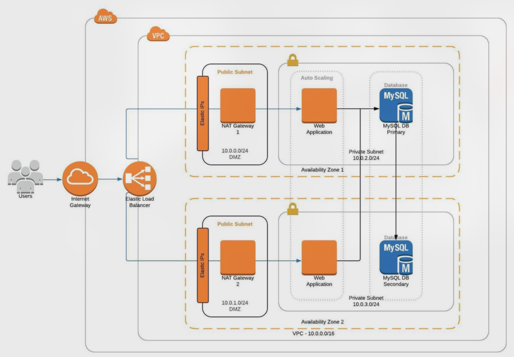

## name

aws-cfn-iac: AWS infrastructure described as code with CloudFormation.
Infrastructure as code on AWS is a way of deploying resources: the stacks, what they create, and how they get deployed.

## synopsis

Write CloudFormation code using this YAML template for building the cloud infrastructure, based on specification and/or requirements.

PARAMETERS FILE:
A JSON file for increasing the generic nature of the YAML code. For example, the JSON file contains a "ParameterKey" and "ParameterValue" which are effectively key-value pairs.

In YAML code, the syntax following the above, as in ${EnvironmentName} would be substituted with UdacityProject accordingly.

Bash scripts: 
create-stack.sh delete-stack.sh update-stack.sh

These are (reusable) helper scripts that can be used to create, delete, and update CloudFormation stacks.

